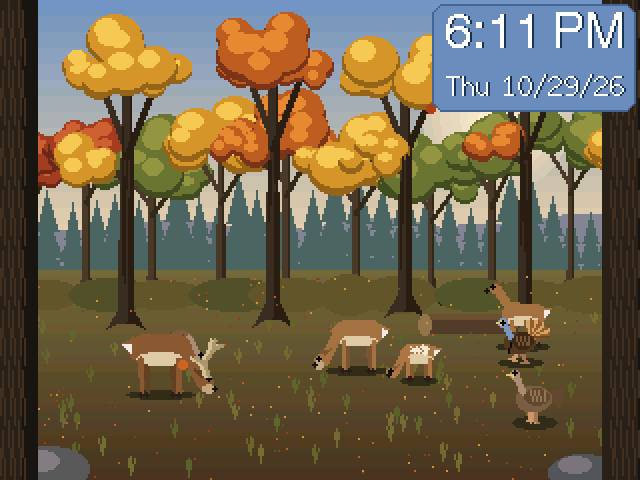

# CYD and Freenove Deer and Turkey display

Animated autumn woods for the Freenove FNK0104S 4.0", the Freenove 2.8" and the CYD 2.8" boards, built the same way as [CYD-and-Freenove-Fish-Tank](https://github.com/Grey-Lancaster/CYD-and-Freenove-Fish-Tank): one 480x320 virtual world, drawn procedurally into a PSRAM sprite (Freenove) or in 30-row strips (CYD).

## Easiest way: the web installer

### [➡ Open the Web Installer](https://grey-lancaster.github.io/CYD-and-Freenove-Deer-and-Turkey-display/)

Use **Chrome or Edge on a computer**, plug the board in by USB, pick your board in the list, click **Connect**, then **Flash**. No software to install. (Freenove boards: hold BOOT, tap RESET, release BOOT first, and press RESET after flashing. The first start asks you to pick your WiFi on the screen.)

Prefer to download files? The [latest release](../../releases/latest) has a factory file (a new board) and an update file (a board that is already running; keeps WiFi and settings) for each of the four builds.

## What it does
A buck, two does, a fawn that trails its mother, a tom turkey and two hens wander the forest floor between layered trees, with leaves drifting down. They walk, graze, stop and look around (the tom fans his tail, the deer flick ears and tails). **Touch the screen to drop a pile of corn**: the nearest animals walk over and eat it. A 25 s woods ambience loop (crows, turkeys, birds) plays, with the crickets and hum filtered out.

- **Clock and date** top-right on a sky-blue plaque (NTP when online, time zone, date format, 12/24 h; "Set time from this device" on the web page for boards without internet; the last time is saved and restored after a restart).
- **Alarm clock**: tap the time on the screen to set it (or use the web page: days, snooze, loudness). A minute before it rings the woods brighten like a sunrise and every animal stops to look up; then the chime plays over a big clock until you tap Stop or Snooze (BOOT also stops it). It sounds even if the woods are muted.
- **WiFi is set up on the screen** with [TouchWifiProvisioner](https://github.com/Grey-Lancaster/TouchWifiProvisioner) (BOOT skips it). Web page at `http://deerhunt.local` (`deerhunt28.local`, `cyddeerhunt.local`): sound and volume, date and time, alarm, flip screen, **swap red/blue** and **invert colours** (for CYD panels), drop corn, forget WiFi, restart.
- **Firmware update page** at `/update` ([ElegantOTA](https://github.com/ayushsharma82/ElegantOTA)) and ArduinoOTA. BOOT shows the connection info.
- A raw screen copy at `/api/frame`; `python design/screenshot.py <host>` turns it into a PNG.

## Builds
| Env | Board |
|---|---|
| `freenove4` (default) | Freenove FNK0104S 4.0", ST7796 480x320, ESP32-S3 N16R8 |
| `freenove28` | Freenove FNK0104B/AB 2.8", ILI9341, ESP32-S3 |
| `cyd28` | CYD 2.8", ILI9341, one USB port |
| `cyd28usb2` | CYD 2.8", ST7789, two USB ports |

`pio run -e <env>`. Wrong colours on a CYD almost always means the wrong env (driver); there are also swap red/blue and invert switches on the web page. Pushing a tag like `v1.0.0` makes CI build all four and publish a release with a factory and an update file for each.

## Layout
- `src/main.cpp` - scene, animals, clock, alarm, web page.
- `src/audio.cpp` - ambience loop and alarm chime. `src/ambience.raw` / `.wav` are generated by `design/make_ambience.py`.
- `src/hal_*.cpp`, `board.h`, `canvas.h`, `es8311.*`, `wifi_setup.*` - board layer carried over from the fish tank.
- `design/preview.py` - PC render of the scene (`woods_*.png`, `woods.mp4`; no clock or alarm screens).
- `docs/` - the web installer (GitHub Pages): `index.html`, `app.js` ([esptool-js](https://github.com/espressif/esptool-js)), and `firmware/deer-hunt-<env>.bin`, the merged full-flash images it writes at offset 0. CI refreshes them on every release tag.
- `tools_build_greyhound.sh` - the author's build-server script (syncs to a server, builds, optionally OTAs); adapt or ignore.

## Status
All four envs compile. Run on a Freenove 2.8" and a one-USB CYD (ILI9341) by the author; the Freenove 4.0" and the ST7789 CYD builds have not been tried on hardware. The CYD runs at about 5 fps (the 2.8" Freenove at about 15).

## Credits
The woods ambience is derived from "Rural Pennsylvania wooded ambience background with wild turkeys, Carolina wren, American crow" by **Jon5515** ([freesound.org/s/871327](https://freesound.org/s/871327/)), licensed [CC BY 4.0](https://creativecommons.org/licenses/by/4.0/). Changes: the first 25 seconds, mixed to mono, noise-reduced, with the cricket band filtered out, looped with a crossfade (`design/make_ambience.py`). The CYD copy is also downsampled to 11.025 kHz to fit in flash.

## License
The code is released under the [MIT License](LICENSE). Two parts keep their own licenses: the ES8311 audio codec driver (`src/es8311*`, Apache-2.0, Espressif) and the FT6336U touch library (`lib_freenove/`, MIT, aselectroworks). The woods ambience loop (`src/ambience.raw`, `src/ambience.wav`) is derived from a recording by Jon5515 and stays under [CC BY 4.0](https://creativecommons.org/licenses/by/4.0/); see Credits.
